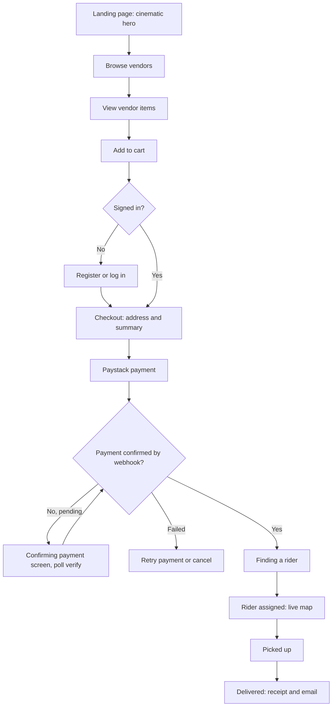
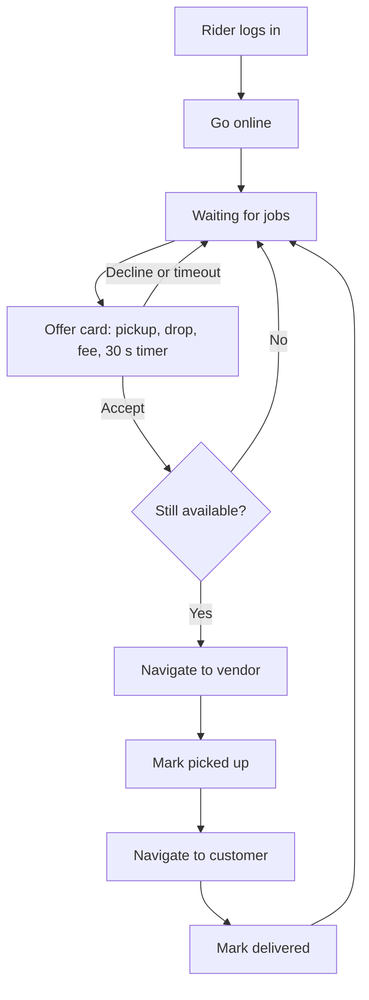
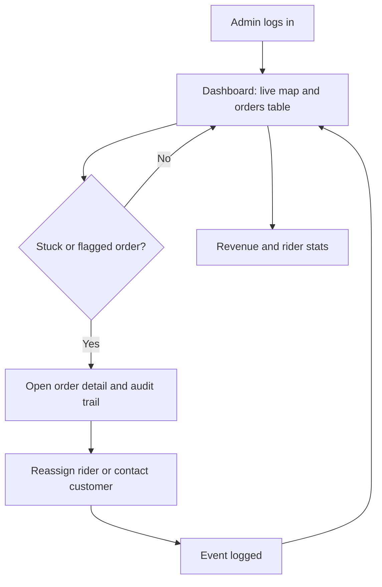

# User journey flow: RELAY

Builds on `prd-relay.md` and `trd-relay.md`.

## Journey 1: Customer places and tracks an order

**Narrative:** the visitor lands on the hero, scrolls into vendors, builds a cart, signs in, pays, waits on a short "finding a rider" state, then watches the rider move until delivery.
**Risk points:** payment redirect return (customer closes tab: order stays recoverable from "My orders"); long rider search (show progress and honest wording after 90 s); lost connection (auto-reconnect and refetch).

## Journey 2: Rider accepts and delivers

**Risk points:** two riders accept at once (loser sees "job taken" and returns to waiting); rider app loses connection (location stops, admin sees "last seen").

## Journey 3: Admin monitors and intervenes

**Risk points:** payment review flag (admin must confirm amount mismatch); reassignment while rider is mid-trip (confirm dialog).
